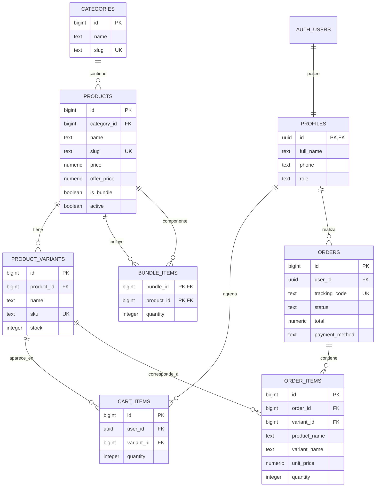

# Modelo de datos — FULL-TECH

## 1. Descripción general

La base de datos de FULL-TECH utiliza PostgreSQL a través de Supabase. Almacena el catálogo de productos, sus variantes y stock, los perfiles de usuarios, los carritos y los pedidos.

Las imágenes del catálogo se almacenan en el bucket público `products` de Supabase Storage.

## 2. Diagrama entidad-relación

`AUTH_USERS` representa los usuarios gestionados por Supabase Auth. La tabla `profiles` referencia `auth.users(id)`.

## 3. Tablas

### `categories`

Almacena las categorías del catálogo.

- `id`: identificador autogenerado.
- `name`: nombre de la categoría.
- `slug`: identificador único utilizado en las URLs.

### `products`

Contiene los productos publicados en la tienda.

- `id`: identificador del producto.
- `category_id`: referencia a `categories`.
- `name` y `slug`: nombre y URL del producto.
- `description`: descripción.
- `price`: precio normal, no negativo.
- `offer_price`: precio promocional opcional.
- `connection_type`: tipo de conexión.
- `compatibility`: lista de dispositivos compatibles.
- `specs`: especificaciones en formato JSONB.
- `images`: lista de URLs de imágenes.
- `is_bundle`: indica si es un Starter Pack.
- `active`: indica si el producto se muestra en la tienda.
- `created_at` y `updated_at`: fechas de creación y actualización.

### `product_variants`

Representa las variantes de un producto y su stock.

- `id`: identificador de la variante.
- `product_id`: referencia a `products`.
- `name`: nombre de la variante; puede ser `Único`.
- `sku`: código único de inventario.
- `stock`: cantidad disponible, no negativa.

### `bundle_items`

Relaciona los Starter Packs con los productos que incluyen.

- `bundle_id`: producto que representa el kit.
- `product_id`: producto que forma parte del kit.
- `quantity`: cantidad incluida, mayor que cero.

La clave primaria compuesta evita repetir el mismo componente dentro del mismo kit.

### `profiles`

Almacena los datos adicionales de cada usuario registrado.

- `id`: UUID relacionado con `auth.users(id)`.
- `full_name`: nombre completo.
- `phone`: teléfono.
- `address`, `city`, `province` y `zip`: datos de domicilio.
- `role`: rol `comprador` o `admin`; por defecto, `comprador`.
- `created_at`: fecha de creación.

### `cart_items`

Almacena las variantes que cada usuario agrega al carrito.

- `id`: identificador del registro.
- `user_id`: referencia al perfil.
- `variant_id`: referencia a la variante.
- `quantity`: cantidad solicitada, mayor que cero.

La combinación `user_id` + `variant_id` es única.

### `orders`

Registra los pedidos realizados por los usuarios.

- `id`: identificador del pedido.
- `user_id`: referencia al perfil.
- `tracking_code`: código de seguimiento único.
- `status`: estado del pedido.
- `total`: importe total, no negativo.
- `shipping_name`, `shipping_address`, `shipping_city`, `shipping_zip` y `shipping_phone`: datos de envío.
- `payment_method`: `tarjeta`, `transferencia` o `efectivo`.
- `created_at`: fecha de creación.

Estados permitidos: `pendiente`, `pagado`, `enviado`, `entregado` y `cancelado`.

### `order_items`

Guarda el detalle de los productos de cada pedido.

- `id`: identificador del detalle.
- `order_id`: referencia al pedido.
- `variant_id`: referencia a la variante.
- `product_name` y `variant_name`: nombres conservados al comprar.
- `unit_price`: precio unitario al momento de la compra.
- `quantity`: cantidad comprada, mayor que cero.

## 4. Relaciones principales

- Una categoría puede contener muchos productos.
- Un producto puede tener varias variantes.
- Un Starter Pack puede incluir varios productos mediante `bundle_items`.
- Cada usuario tiene un perfil.
- Un usuario puede tener varios artículos en su carrito y realizar varios pedidos.
- Cada pedido puede contener varios detalles en `order_items`.
- Cada artículo del carrito y cada detalle del pedido referencia una variante.

## 5. Seguridad

Todas las tablas del esquema `public` tienen Row Level Security (RLS) activado.

Las políticas de lectura pública permiten consultar:

- Categorías.
- Productos activos.
- Variantes correspondientes a productos activos.

Las demás tablas no tienen políticas de acceso público. Las operaciones de negocio se realizan mediante la API del backend, que utiliza la clave `service_role` desde el entorno seguro del servidor.

La clave `service_role` nunca debe exponerse en el frontend ni subirse a GitHub.

## 6. Imágenes de productos

Las imágenes se almacenan en el bucket público `products` de Supabase Storage. Las URLs se guardan en la columna `images` de `products`.

El carácter público del bucket permite visualizar las imágenes; los permisos de carga, modificación y eliminación deben controlarse por separado.

## 7. Migraciones

Las migraciones se encuentran en `supabase/migrations/` y deben aplicarse en orden:

1. `001_catalogo.sql`: categorías, productos, variantes, componentes de Starter Packs y RLS inicial.
2. `002_profiles.sql`: perfiles y roles.
3. `003_carrito_pedidos.sql`: carritos, pedidos y detalles de pedidos.
4. `004_indices.sql`: índices de consulta y trigger para `updated_at`.
5. `005_rls.sql`: RLS y políticas de lectura pública.
6. `006_storage.sql`: bucket público `products`.

Las migraciones ejecutadas no deben editarse. Los cambios posteriores deben agregarse mediante nuevas migraciones numeradas.
